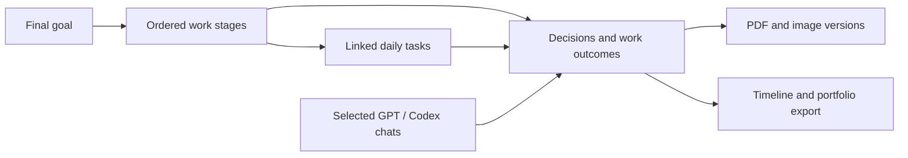

# Work artifacts and records

An artifact has a final goal and an ordered flow. Each stage contains work records and selected reports. A task can finish or disappear from the daily planner while its records and reports stay available.



The **작업물** screen has three tabs:

- **흐름** shows stage status and dated records. Select a stage to read its history.
- **자료** shows files and links from all visible records in the selected artifact. Add a file or link with a note. Expand a note or the edit menu when needed. The server selects materials before pagination, so older attachments remain available.
- **정리** holds the goal, background, contribution, decisions, results, and reflection. Select **정리 편집** to edit these fields and the representative result link. Empty fields stay out of the read view and export.

These views use the same daylight records. They do not import records from other applications. Use the daily task menu to link a task to an artifact and a stage. Actual task and subtask completion changes create records, including changes from the Mac widget. Completion history uses the change time, not the task's planned date.

Records can include decisions, progress, results, or accepted next actions. The user controls stage completion and can correct a record's text or association. A star selects a record for the portfolio export. Use **정리** to export the portfolio or full timeline. Exports include the project summary, stage flow, dated records, and report links. Attached file links require the owner's login.

## Data and access

- `work_artifacts` holds the final goal, representative link, and optional project summary fields. Each summary field accepts up to 4,000 characters.
- `work_stages` holds the ordered flow and stage status.
- `work_task_links` links existing tasks to artifacts and stages.
- `work_entries` holds dated records and their provenance. A stable source key prevents duplicates. Hidden records retain that key. Deleting a task keeps its records.
- `work_files` holds attachment metadata and checksums. `work_file_chunks` holds selected report and image bytes in the existing D1 database. Identical content on one record is deduplicated. A revised report has a new file ID. Metadata and bytes are saved in one transaction.
- `work_connections` holds one scoped source connection. The database stores a hash of the credential. A connection expires after 90 days and can be revoked.

All work records, connection metadata, and attachments are owner-only. The existing **서로의 오늘** task-sharing behavior stays in place. An accepted next action imported as a daily task follows that existing sharing behavior. Project source files are not copied to the server.

The importer uses one D1 transaction for new records and their new tasks. Duplicate imports never overwrite a manual correction, unhide a record, or recreate a deleted task. It never sets completion state. No OpenAI API key or separate model call is used by the Worker. The local agent interprets the selected chats and submits structured outcomes.

## Run this branch locally

Use Node.js 24 or later and the installed dependencies. The existing local database is separate from production.

```sh
npm run dev -- --hostname 127.0.0.1 --port 5173
```

If `dist/server/wrangler.json` is absent, run `npm run build` first to create the local configuration. Apply each SQL file in `drizzle/` once, in order, to the local database. Some existing local databases have no migration ledger. Do not apply all files again to those databases. Migration `0004_work_log.sql` adds the work tables and completion triggers. Migration `0005_work_file_storage.sql` adds file storage. Migration `0006_work_project_summary.sql` adds empty project summary fields. It does not change existing records. The existing development sign-in behavior remains in use.

The Google Worker uses the existing D1 binding for uploads. An R2 subscription is not required. Apply pending migrations before deploying the branch. Keep the original Sites manifest and database separate. Deployment does not enable a collection schedule.

Each file can be up to 10 MB. The total attachment limit is 200 MB for this deployment. Uploads stop at that limit. The limit leaves database space for tasks and records. The existing Workers Free plan rejects requests at its service limits; it does not upgrade the account automatically. See [D1 pricing](https://developers.cloudflare.com/d1/platform/pricing/). An optional existing R2 binding can still read files from older local builds. New uploads always use D1.

## Connect selected chats

1. Open an artifact. Expand **GPT·Codex 기록 연결**.
2. Select Codex or ChatGPT. Enter the Codex project folder or the ChatGPT project or conversation URL.
3. Create and download the connection file. Keep this private credential out of Git.
4. Ask Codex to use `skills/daylight-work-log/SKILL.md` with that file. The first import confirms source access and writes a scoped set of outcomes.
5. After a successful import, use the desktop app's scheduled-task tool for recurring collection.

The host supplies `list_threads`, `list_projects`, and `read_thread`. A Worker cannot call those desktop tools itself. Tool access in a scheduled run must be available. If a tool or project cannot be resolved, the collector reports the missing connection rather than claiming a sync. Local scheduled work needs the Mac and desktop app running. See [official scheduled-task documentation](https://learn.chatgpt.com/docs/automations).

## Collector contract

Use `scripts/work-log-client.mjs context CONNECTION_FILE` to read the selected source, goal, stages, linked tasks, and recent known IDs. The credential is read from the file and never passed on the command line. HTTPS is required, except for a local loopback development server. Redirects are rejected.

Send a JSON object on stdin to `scripts/work-log-client.mjs import CONNECTION_FILE`:

```json
{
  "entries": [{
    "sourceKey": "chat-id/turn-id/report-result",
    "kind": "result",
    "title": "Completed the model comparison",
    "body": "Compared the two models and saved the revised report.",
    "occurredAt": "2026-11-10T16:30:00+09:00",
    "stageId": "stage-id-from-context",
    "links": [{"label": "Results", "url": "https://example.com/results"}]
  }]
}
```

Each request accepts up to five records. This keeps the ownership queries within the [D1 Free request limit](https://developers.cloudflare.com/d1/platform/limits/). Kinds are `plan`, `decision`, `progress`, and `result`. `stageId`, `taskId`, `subtaskId`, and `sourceUrl` are optional. Existing task IDs must belong to the owner and selected artifact. Set `needsReview: true` with no stage or task ID for an uncertain artifact match.

For an accepted, dated next action, a `plan` entry can include `plannedTask` with `title`, `date`, and optional `endDate`. A newly accepted task appears in the daily planner. Use an existing `taskId` when a task is already linked. Keep the source key stable across retries. Later turns get new source keys and retain their own occurrence times.

The response includes imported and duplicate counts, created-task count, and record IDs. Use `scripts/work-log-client.mjs upload CONNECTION_FILE ENTRY_ID REPORT_FILE` to attach a chosen PDF, PNG, JPG, GIF, or WebP file. Each file can be up to 10 MB; each record can hold 20 files. New record versions keep old attachments.

The bounded regression check is `node scripts/check-work-log.mjs`. It uses an in-memory database. It does not change production data.
